```markdown
<div dir="rtl">

# 📖 سامانه جامع قرآن کریم | Quran Pro (Material 3)

<p align="center">
  
  
  
  
  
</p>

<p align="center">
  <b>یک وب‌اپلیکیشن جامع، فوق‌سبک و بدون وابستگی (Zero-Dependency) برای قرائت، مطالعه تطبیقی تفاسیر، و استماع ترتیل کلام‌الله مجید بر پایه زبان طراحی مدرن Material Design 3 گوگل.</b>
</p>

<p align="center">
  <a href="#-دموی-آنلاین">مشاهده دمو</a> •
  <a href="#-گالری-تصاویر">تصاویر رابط کاربری</a> •
  <a href="#-ویژگی‌های-کلیدی">ویژگی‌ها</a> •
  <a href="#-معماری-و-ساختار-فنی">معماری فنی</a> •
  <a href="#-قاریان-و-قلم‌های-پشتیبانی‌شده">قاریان و فونت‌ها</a> •
  <a href="#-نحوه-اجرا-و-استفاده">راه‌اندازی</a> •
  <a href="#-دیاگرام‌های-فنی-و-معماری-سیستم-plantuml">دیاگرام‌های مهندسی</a>
</p>

---

## 🌟 دموی آنلاین

شما می‌توانید پیش‌نمایش زنده این سامانه را مستقیماً در بستر آنلاین مشاهده فرمایید:

👉 **[مشاهده دمو در CodePen](https://codepen.io/editor/Silent-Galaxy/pen/01a192b0-cbd7-7082-8434-665dfe2d6fae)**

> [!TIP]
> این برنامه بدون نیاز به هیچ‌گونه نصب یا بیلد (Zero-Build) مستقیماً روی تمام مرورگرهای دسکتاپ و موبایل اجرا می‌شود.

---

## 🖼 گالری تصاویر

<table align="center" width="100%">
  <tr>
    <td align="center" width="50%">
      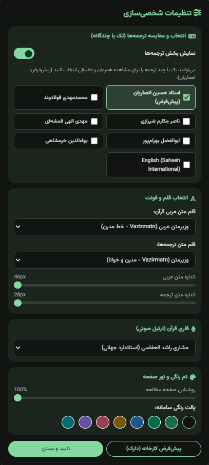
      <br><sub><b>نمای اصلی و متن آیات همراه با ترجمه</b></sub>
    </td>
    <td align="center" width="50%">
      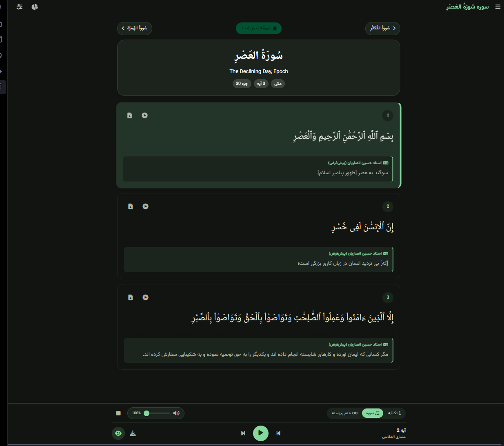
      <br><sub><b>کشوی فهرست ۱۱۴ سوره و جستجوی لحظه‌ای</b></sub>
    </td>
  </tr>
  <tr>
    <td align="center" width="50%">
      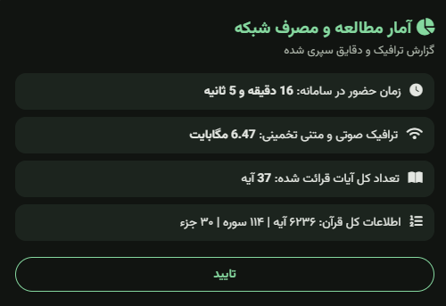
      <br><sub><b>پنل تنظیمات فونت، تم‌ها و ترجمه‌ها</b></sub>
    </td>
    <td align="center" width="50%">
      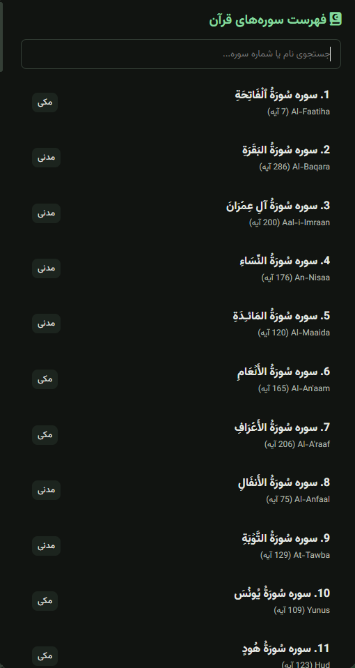
      <br><sub><b>مطالعه تطبیقی همزمان چند ترجمه</b></sub>
    </td>
  </tr>
  <tr>
    <td colspan="2" align="center">
      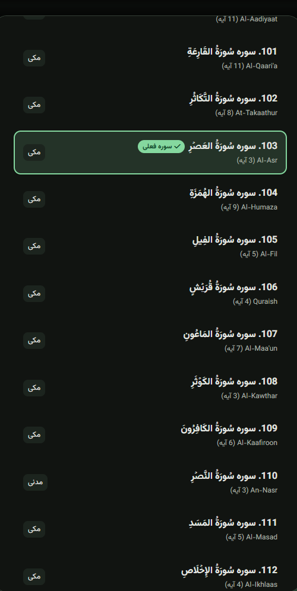
      <br><sub><b>پلیر صوتی شناور با قابلیت تنظیم سرعت و ولوم</b></sub>
    </td>
  </tr>
</table>

---

## ✨ ویژگی‌های کلیدی

### 🔠 مطالعه تطبیقی چند ترجمه به صورت همزمان
- مشاهده موازی چند ترجمه معتبر زیر هر آیه:
  - استاد حسین انصاریان
  - آیت‌الله مکارم شیرازی
  - دکتر محمد مهدی فولادوند
  - مهدی الهی قمشه‌ای
  - ابوالفضل بهرام‌پور
  - بهاءالدین خرمشاهی
  - Saheeh International (انگلیسی)
- امکان فعال یا غیرفعال‌سازی تک‌تک ترجمه‌ها طبق نیاز پژوهشگر.

### 🎨 رنگ‌آمیزی هوشمند علائم وقف و تجوید (Regex-Powered)
تشخیص و استایل‌دهی هوشمند بر اساس استانداردهای یونیکد رسم‌الخط عثمان طه:
- 🔴 **وقف لازم (مـ):** قرمز هشداردهنده
- 🌸 **وقف ممنوع (لا):** صورتی یاقوتی
- 🟣 **سکته:** بنفش اختصاصی
- 🟡 **وقف جایز (ج، قلی، صلی):** طلایی چشم‌نواز
- 🔷 **علامت حزب و سجده واجب:** نشانه‌گذاری متمایز فیروزه‌ای

### 🎧 پلیر پیشرفته صوتی و دنبال‌کننده تلاوت
- **۳ حالت تلاوت هوشمند:**
  1. *تک‌آیه:* توقف پس از پایان آیه جاری
  2. *سوره کامل:* پخش ترتیل تا انتهای سوره
  3. *ختم پیوسته:* ادامه خودکار تلاوت و بارگذاری سوره‌های بعدی بدون وقفه
- **Auto-Scroll هوشمند:** هدایت نرم صفحه و هایلایت بصری همزمان با صدای قاری.
- **کنترل بلندی صدا (Volume Slider):** تنظیم ولوم از داخل رابط بدون نیاز به کلیدهای فیزیکی دستگاه.
- امکان دانلود تکی صوت هر آیه یا صف دانلود تمام سوره.

### 🌙 سلامت چشم و تم‌های چندگانه
- حالت شب (Dark Mode) پیش‌فرض و ارگونومیک جهت جلوگیری از خستگی چشم.
- اسلایدر نرم‌افزاری کاهش نور صفحه برای مطالعه در تاریکی مطلق (Brightness Dimmer).
- **۸ پالت رنگی داینامیک:** *زمردی، سرمه‌ای، طلایی، یاقوتی، بنفش، فیروزه‌ای، زیتونی و کهربایی*.

### ⚡ ذخیره‌سازی ابری و عملکرد بدون نیاز به سرور
- ثبت خودکار آخرین آیه خوانده شده (Bookmark) و پرش سریع به آن در مراجعات بعدی.
- سیستم آمار داخلی جهت محاسبه زمان مطالعه و تخمین حجم اینترنت مصرفی.

---

## 🛠 معماری و ساختار فنی

این نرم‌افزار به صورت **Single-File Application** طراحی شده و نیازی به هیچ مرحله کامپایل (`npm build`, `webpack`, `vite`) ندارد.

```text
quran-pro-material3/
├── index.html       # شامل تگ‌های سمانتیک، لایوت اصلی و ساختار دسترسی‌پذیری
├── CSS (Embedded)   # توکن‌های متریال ۳، متغیرهای CSS (:root)، مدیاکوئری‌های ریسپانسیو
└── JS (Embedded)    # مدیریت وضعیت (APP_STATE)، تعامل با API، کنترل رویدادهای Audio و DOM
```

### استانداردهای به‌کار رفته:
1. **Material Design 3 Tokenization:** تعویض آنی رنگ‌بندی با تغییر متغیرهای پویا بدون رندر مجدد DOM.
2. **RESTful API Consumption:** واکشی دینامیک بسته‌های سوره‌ها از سرویس مرجع `api.alquran.cloud`.
3. **Data Persistence:** نگه‌داری اطلاعات سشن، تنظیمات و نشانک در `Window.localStorage`.
4. **Regular Expression Parsing:** پردازش رشته‌های حاوی نمادهای عثمان‌طه بر پایه استانداردهای یونیکد زبان عربی:
   ```javascript
   text.replace(/([\u06D8])/g, '<span class="quran-mark mark-lazim">$1</span>');
   ```

---

## 🎙️ قاریان و قلم‌های پشتیبانی‌شده

| فونت‌های قرآنی و متنی | قاریان برجسته جهان اسلام |
| :--- | :--- |
| • **امیری قرآنی** (Amiri Quran - عثمان طه) | • **مشاری راشد العفاسی** |
| • **شهرزاد نسخ** (Scheherazade New) | • **عبدالباسط عبدالصمد** (مجود) |
| • **نوتو نسخ گوگل** (Noto Naskh Arabic) | • **محمد صدیق منشاوی** |
| • **وزیرمتن** (Vazirmatn) | • **سعود الشریم** |
| • **لطیف** (Lateef) | • **شهریار پرهیزگار** (تلاوت آموزشی) |

---

## 🚀 نحوه اجرا و استفاده

برای اجرای این پروژه روی سیستم خود تنها به یک مرورگر مدرن نیاز دارید:

```bash
# ۱. کلون کردن مخزن
git clone https://github.com/YOUR_USERNAME/quran-pro-material3.git

# ۲. ورود به پوشه پروژه
cd quran-pro-material3

# ۳. اجرای فایل index.html (دوبار کلیک روی فایل یا باز کردن در مرورگر)
```

یا با استفاده از سرور محلی پایتون:
```bash
python3 -m http.server 8000
```
سپس آدرس `http://localhost:8000` را در مرورگر باز کنید.

---

## 📐 دیاگرام‌های فنی و معماری سیستم (PlantUML)

این دیاگرام‌ها زوایای مختلف معماری (ارتباطات سیستم، چرخه داده، ماشین وضعیت صوتی، پایپ‌لاین پردازش تجوید، ساختار کامپوننت‌ها و سفر کاربر) را پوشش می‌دهند.

> [!NOTE]
> کدهای هر بخش را می‌توانید مستقیماً در **[ادیتور آنلاین PlantUML](https://editor.plantuml.com/)** کپی و مشاهده فرمایید.

---

### ۱. دیاگرام معماری کلان سامانه (System Architecture Diagram)
> **هدف:** درک رابطه برنامه تک‌صفحه‌ای (Client-Side) با سرویس‌های ابری، شبکه CDN و حافظه محلی مرورگر.

<p align="center">
  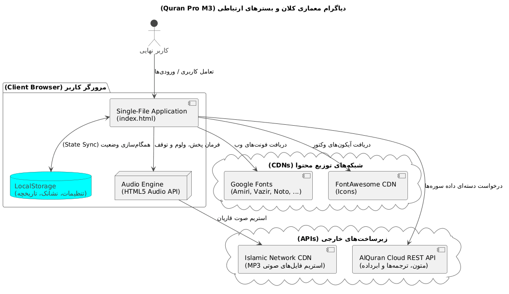
</p>

<details>
<summary><b>🔍 مشاهده سورس کد PlantUML</b></summary>

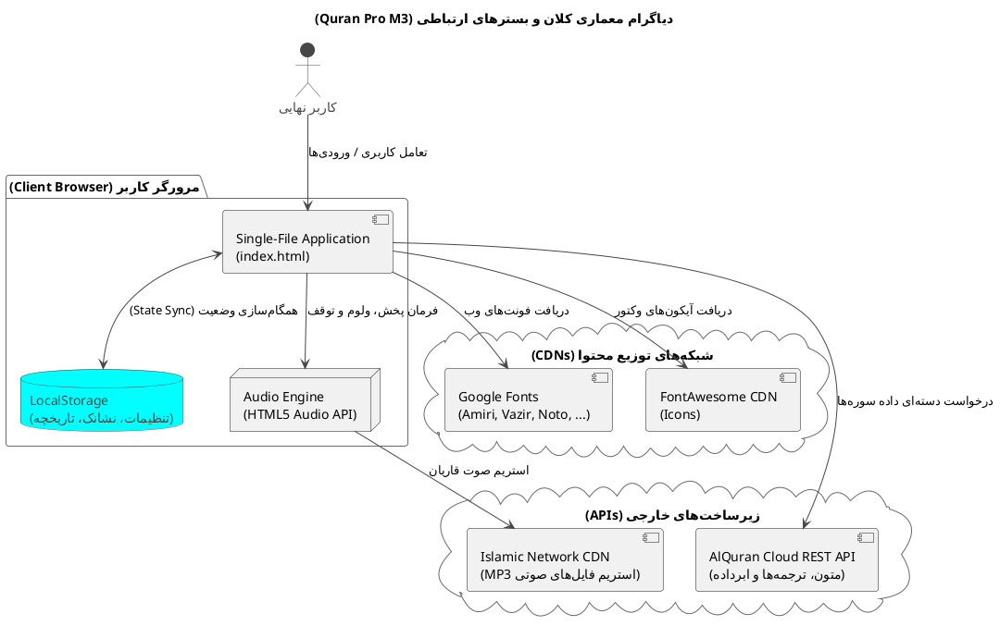
</details>

---

### ۲. دیاگرام توالی بارگذاری سوره و ترجمه‌ها (Sequence Diagram)
> **هدف:** نمایش دقیق ترتیبات رویدادها از زمان انتخاب یک سوره تا پردازش، استخراج ترجمه‌ها و رندرینگ کارت‌ها روی صفحه.

<p align="center">
  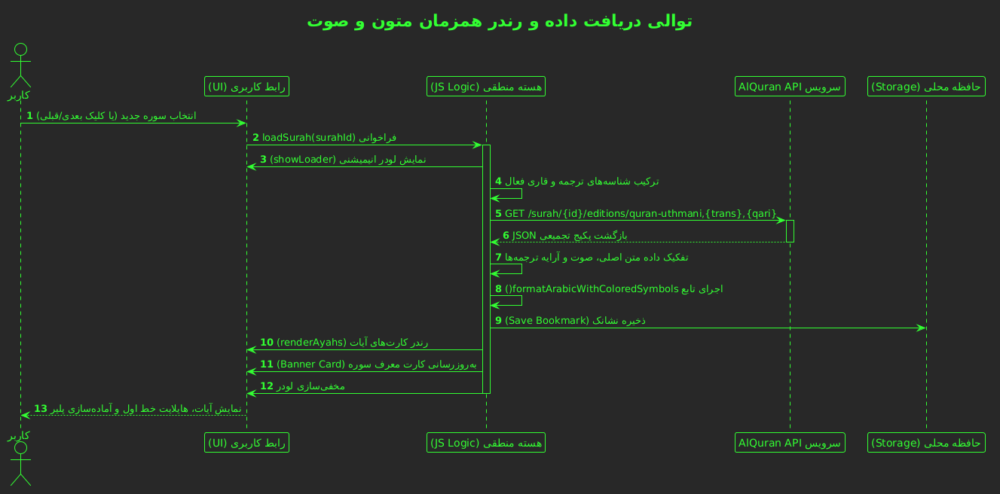
</p>

<details>
<summary><b>🔍 مشاهده سورس کد PlantUML</b></summary>

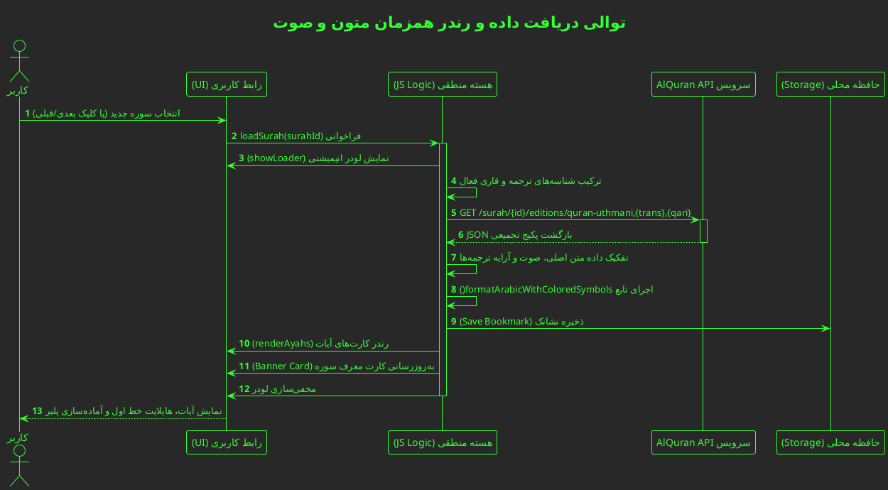
</details>

---

### ۳. دیاگرام ماشین وضعیت پلیر صوتی (Audio State Machine)
> **هدف:** تشریح چگونگی مدیریت پخش پیوسته، رفتار پایان هر آیه بر اساس ۳ مود (تک‌آیه، سوره، ختم پیوسته)، و هماهنگی اسکرول خودکار.

<p align="center">
  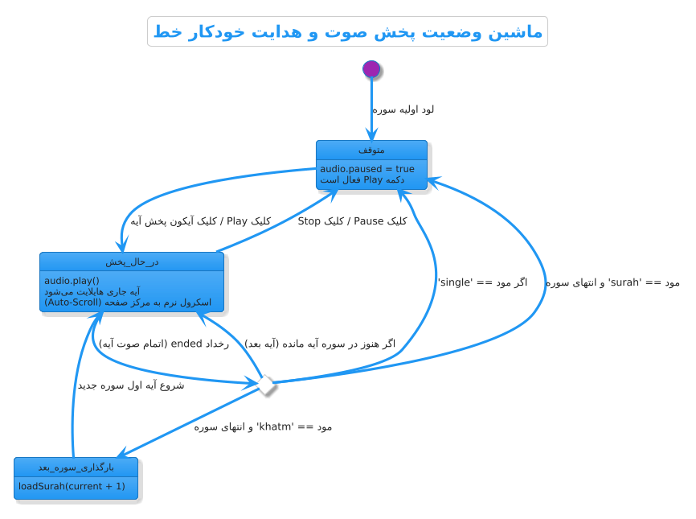
</p>

<details>
<summary><b>🔍 مشاهده سورس کد PlantUML</b></summary>

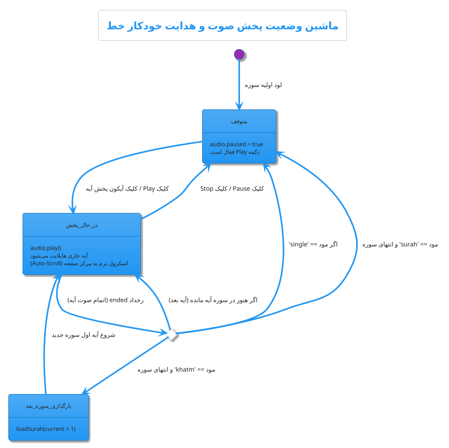
</details>

---

### ۴. خط لوله پردازش علائم تجوید و وقف (Data Pipeline Diagram)
> **هدف:** بررسی زیرکاپوت نحوه تبدیل متون خام عثمان‌طه حاوی کدهای نامرئی یونیکد به المان‌های بصری غنی و رنگی.

<p align="center">
  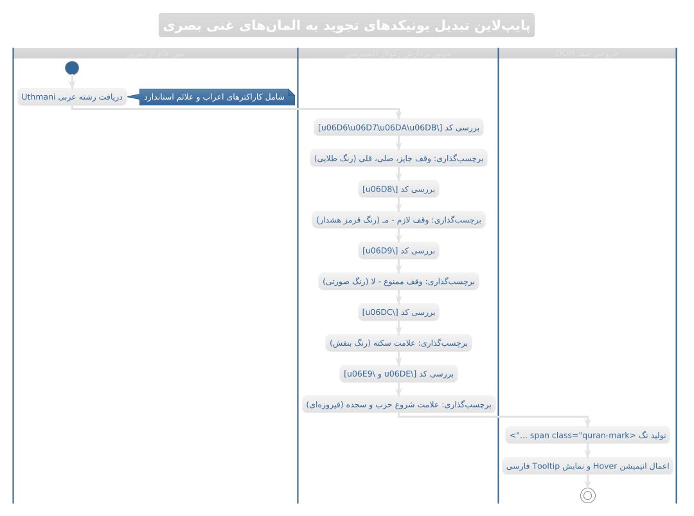
</p>

<details>
<summary><b>🔍 مشاهده سورس کد PlantUML</b></summary>

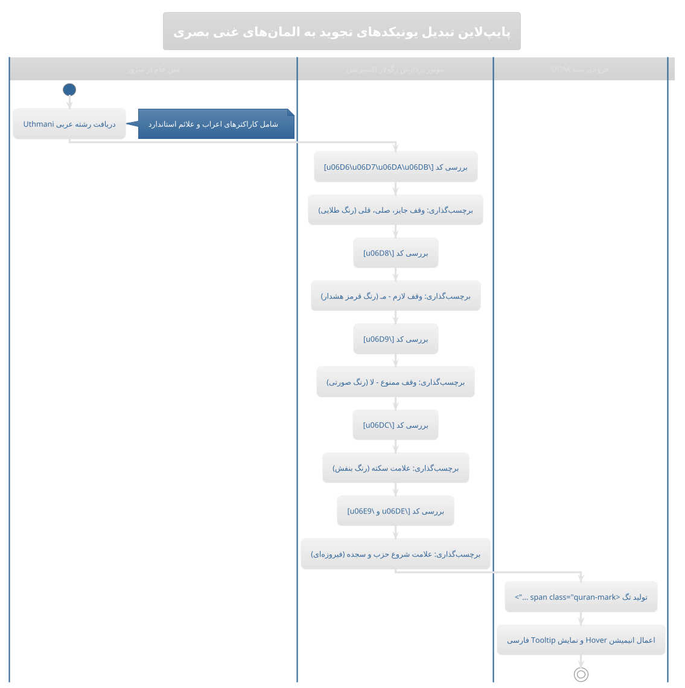
</details>

---

### ۵. ساختار مدل داده وضعیت برنامه (State & Storage Class Diagram)
> **هدف:** نمایش شکل داده‌های متمرکز در `APP_STATE` و نحوه نگه‌داری ساختاریافته آبجکت‌ها درون حافظه.

<p align="center">
  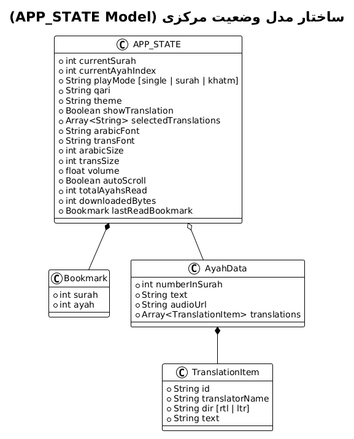
</p>

<details>
<summary><b>🔍 مشاهده سورس کد PlantUML</b></summary>

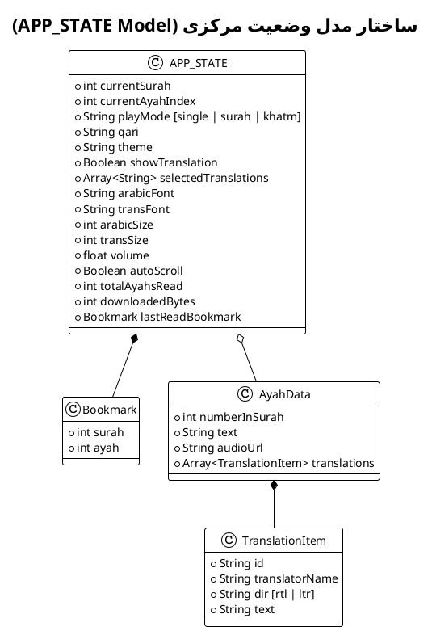
</details>

---

### ۶. نقشه درختی اجزای رابط کاربری (Component Hierarchy Diagram)
> **هدف:** تفکیک ماژولار تمامی پنل‌ها، المان‌های شناور و پنجره‌های پاپ‌آپ داخل ساختار صفحه.

<p align="center">
  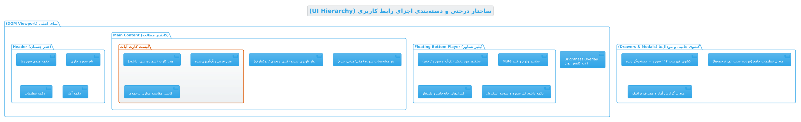
</p>

<details>
<summary><b>🔍 مشاهده سورس کد PlantUML</b></summary>

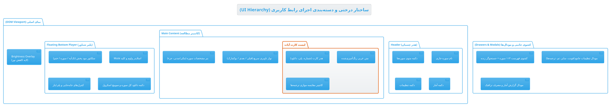
</details>

---

### ۷. دیاگرام سفر و جریان کاربری (User Journey Activity Diagram)
> **هدف:** توصیف تمام مسیرهایی که یک مخاطب (از ورود، تغییر شخصی‌سازی، تا مطالعه و ختم) می‌تواند در سامانه طی کند.

<p align="center">
  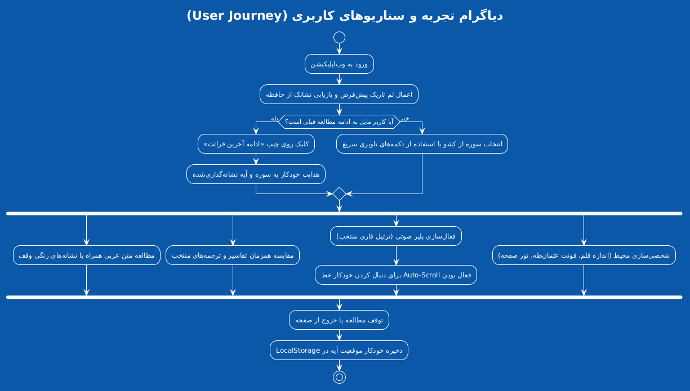
</p>

<details>
<summary><b>🔍 مشاهده سورس کد PlantUML</b></summary>

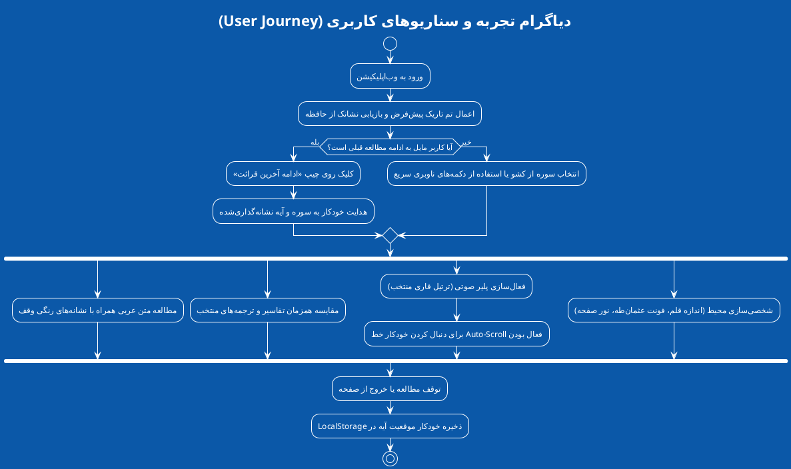
</details>

---

## 🤝 مشارکت در توسعه (Contributing)

پیشنهادات، گزارش باگ‌ها و افزودن ترجمه‌ها یا قابلیت‌های جدید صمیمانه استقبال می‌شود:

1. این ریپازیتوری را Fork کنید.
2. یک شاخه (Branch) برای قابلیت جدید بسازید:
   ```bash
   git checkout -b feature/NewAwesomeFeature
   ```
3. تغییرات خود را Commit کنید:
   ```bash
   git commit -m 'feat: Add NewAwesomeFeature'
   ```
4. شاخه خود را Push کنید:
   ```bash
   git push origin feature/NewAwesomeFeature
   ```
5. یک Pull Request ارسال کنید.

---

## 📄 لایسنس

این پروژه تحت مجوز **MIT** منتشر شده است. استفاده، بازنشر و شخصی‌سازی آن برای تمامی اهداف غیرتجاری و تجاری کاملاً آزاد و رایگان است.

<p align="center">
  <b>با آرزوی بهره‌مندی و آرامش در تلاوت کلام وحی ✨</b>
</p>

</div>
```