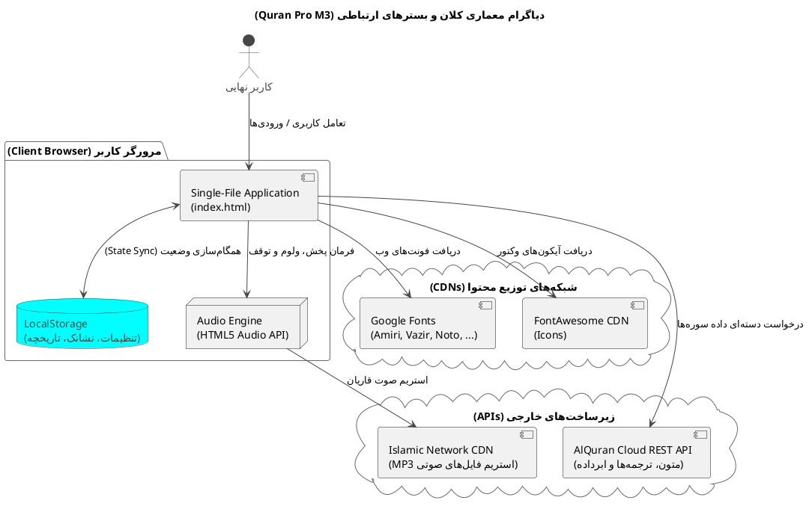
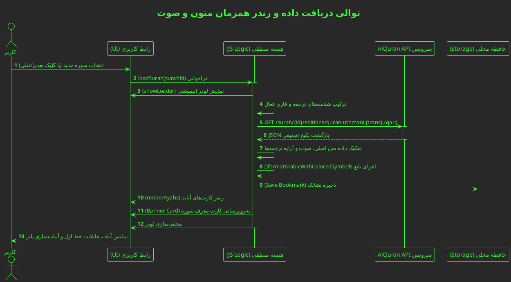
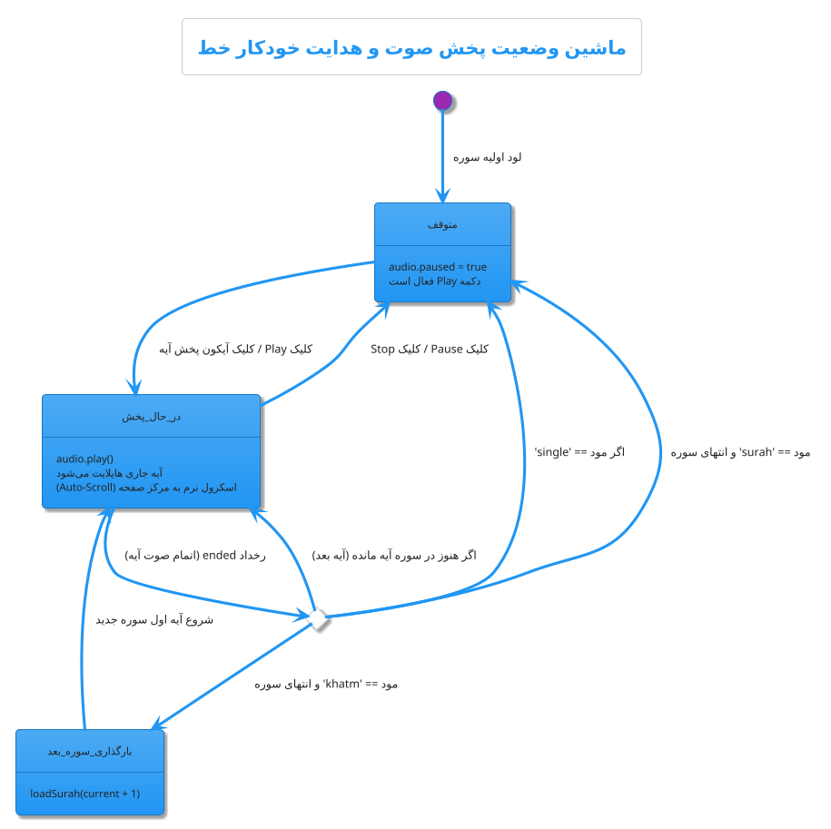
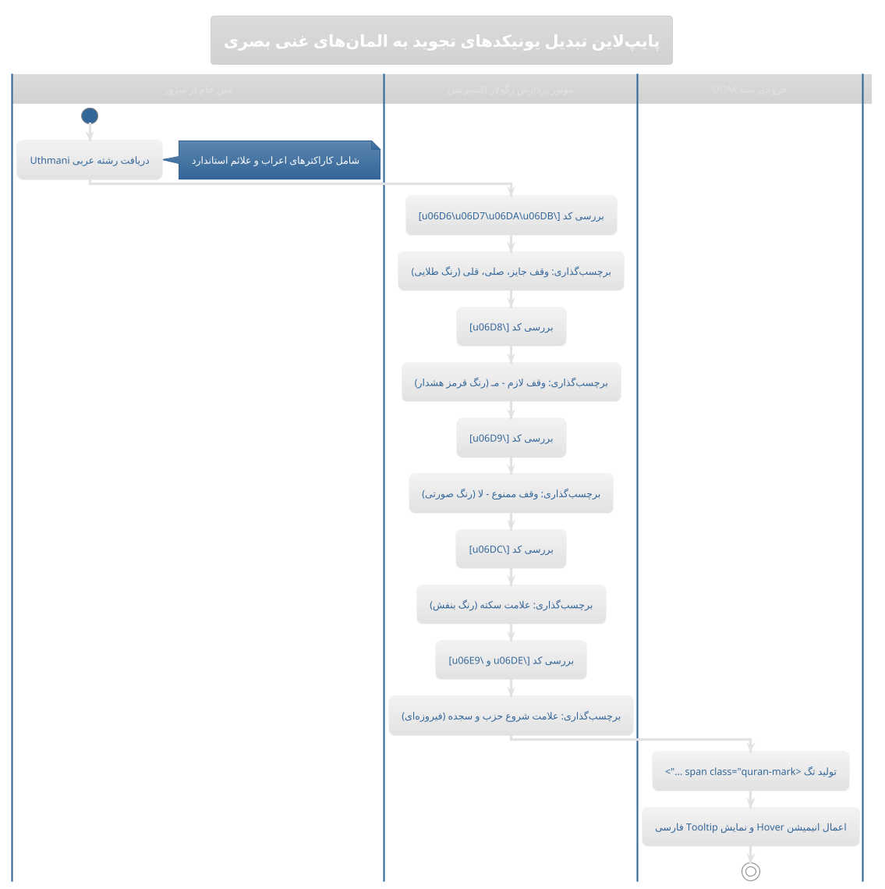
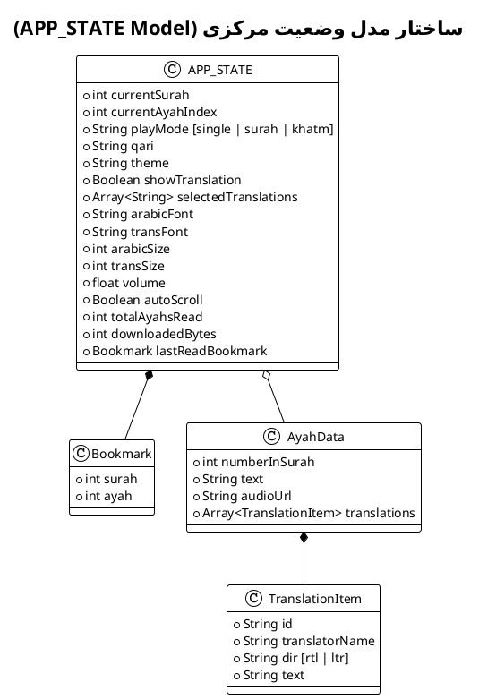
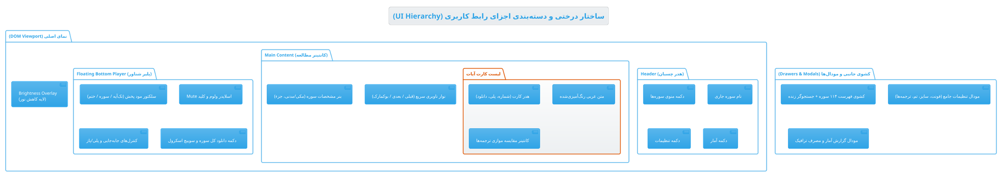
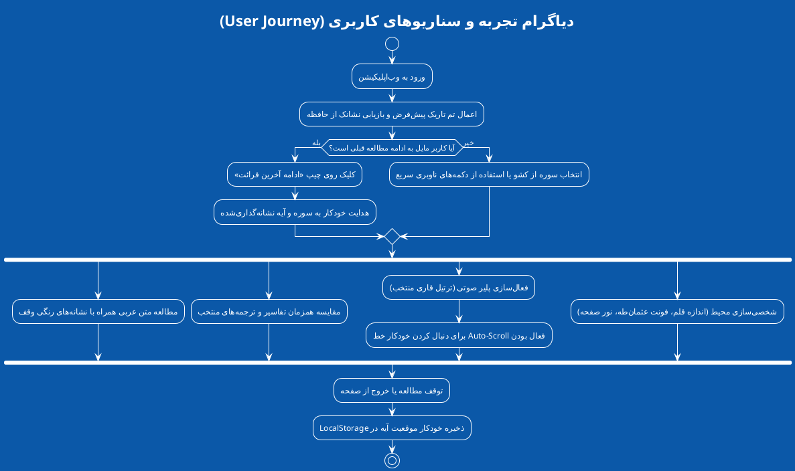

```markdown
<div align="center">

# 📖 سامانه جامع قرآن کریم | Quran Pro (Material 3)

[](https://github.com)
[](https://github.com)
[](https://m3.material.io)
[](https://alquran.cloud/api)
[](LICENSE)

<p align="center">
  <b>یک وب‌اپلیکیشن جامع، فوق‌سبک و بدون وابستگی (Zero-Dependency) برای قرائت، مطالعه تطبیقی تفاسیر و استماع ترتیل کلام‌الله مجید بر پایه زبان طراحی Google Material Design 3.</b>
</p>

[🌐 پیش‌نمایش زنده](#-دموی-آنلاین) •
[✨ ویژگی‌ها](#-ویژگی‌های-کلیدی) •
[📐 معماری و دیاگرام‌ها](#-معماری-فنی-و-دیاگرام‌های-سیستم) •
[🎙️ قاریان و قلم‌ها](#️-قاریان-و-قلم‌های-پشتیبانی‌شده) •
[🚀 نحوه راه‌اندازی](#-نحوه-راه‌اندازی-و-استفاده) •
[🤝 مشارکت](#-مشارکت-در-توسعه-contributing)

</div>

---

## 🌟 دموی آنلاین

> [!TIP]
> برای تجربه زنده و بدون نیاز به نصب، روی لینک زیر کلیک کنید:
> 
> 👉 **[مشاهده و اجرای پروژه در CodePen](https://codepen.io/editor/Silent-Galaxy/pen/01a192b0-cbd7-7082-8434-665dfe2d6fae)**

---

## 🖼️ گالری تصاویر

<div align="center">
  <table>
    <tr>
      <td width="50%"></td>
      <td width="50%"></td>
    </tr>
    <tr>
      <td width="50%"></td>
      <td width="50%"></td>
    </tr>
    <tr>
      <td colspan="2" align="center"></td>
    </tr>
  </table>
</div>

---

## ✨ ویژگی‌های کلیدی

### 🔠 مطالعه تطبیقی چند ترجمه به صورت همزمان
- مشاهده موازی چند ترجمه معتبر زیر هر آیه (استاد انصاریان، مکارم شیرازی، فولادوند، الهی قمشه‌ای، بهرام‌پور، خرمشاهی و Saheeh International انگلیسی).
- امکان فعال یا غیرفعال‌سازی گزینشی هر ترجمه به تناسب نیاز کاربر.

### 🎨 رنگ‌آمیزی هوشمند علائم وقف و تجوید (Regex-Powered)
- شناسایی خودکار کدهای یونیکد علائم مصحف شریف بر پایه Regex:
  - **وقف لازم (مـ):** تفکیک بصری قرمز با برچسب هشدار
  - **وقف ممنوع (لا):** نشانه‌گذاری صورتی یاقوتی
  - **علامت سکته (س):** هایلایت بنفش اختصاصی
  - **شروع حزب و سجده:** برچسب فیروزه‌ای متمایز

### 🎧 موتور صوتی پیشرفته و رهگیری هوشمند خط
- **۳ حالت تلاوت:** تک‌آیه، سوره کامل و ختم پیوسته قرآن (انتقال خودکار بین سوره‌ها).
- **Auto-Scroll هوشمند:** حرکت نرم صفحه و مشخص کردن آیه جاری هماهنگ با صوت قاری.
- **کنترل صوتی درون‌برنامه‌ای:** اسلایدر تنظیم حجم صدا بدون وابستگی به کلیدهای سخت‌افزاری.
- دانلود مستقیم صوت هر آیه یا دانلود یکپارچه کل سوره.

### 🌙 سلامت چشم و بهینه‌سازی ارگونومیک
- حالت شب (Dark Mode) پیش‌فرض با رعایت دقیق کنتراست رنگی متریال ۳.
- اسلایدر کاهش نور نرم‌افزاری (Brightness Dimmer) برای مطالعه در تاریکی مطلق.
- ۸ پالت رنگی داینامیک: *زمردی، سرمه‌ای، طلایی، یاقوتی، بنفش، فیروزه‌ای و ...*

### ⚡ ذخیره‌سازی محلی و عملکرد بی‌نیاز از سرور
- ذخیره خودکار آخرین موقعیت مطالعه (Bookmark) و بازگشت آنی در مراجعات بعدی.
- داشبورد آماری داخلی برای پایش زمان مطالعه و تخمین حجم اینترنت مصرفی.

---

## 🛠 معماری و ساختار فنی

این سامانه به صورت **Single-File Application** پیاده‌سازی شده و نیازی به فرایند ساخت یا باندلر (`Webpack`, `Vite`, `npm build`) ندارد.

```text
quran-pro-material3/
├── index.html           # ساختار سمانتیک، لی‌آوت اصلی و دسترس‌پذیری (ARIA)
├── CSS (Embedded)       # متغیرهای CSS (:root)، توکن‌های Material Design 3 و رسپانسیو
└── JS (Embedded)        # مدیریت وضعیت (State)، کنترل DOM، موتور Audio و AlQuran API
```

### اصول مهندسی به‌کار رفته:
1. **Material Design 3 Tokens:** تغییر داینامیک رنگ‌ها و متغیرهای بصری بدون نیاز به بازنشانی DOM.
2. **REST API Integration:** دریافت بهینه‌سازی‌شده دسته‌های داده از سرویس `api.alquran.cloud`.
3. **Data Persistence:** ذخیره‌سازی داده‌های سشن، تنظیمات شخصی‌سازی و بوکمارک در `localStorage`.
4. **Unicode Regex Engine:** پارس متون و اعراب‌گذاری علائم عثمان‌طه:
   ```javascript
   text.replace(/([\u06D8])/g, '<span class="quran-mark mark-lazim">$1</span>');
   ```

---

## 📐 معماری فنی و دیاگرام‌های سیستم

<details open>
<summary><b>۱. دیاگرام معماری کلان (System Architecture)</b></summary>
<br>

نمای ارتباطی میان کلاینت، APIهای خارجی، شبکه توزیع محتوا (CDN) و حافظه محلی مرورگر:

<p align="center">
  
</p>

<details>
<summary>نمایش کد منبع PlantUML</summary>


</details>
</details>

---

<details open>
<summary><b>۲. دیاگرام توالی واکشی و رندر داده (Sequence Diagram)</b></summary>
<br>

چرخه بارگذاری سوره، تفکیک ترجمه‌ها، پردازش اعراب و به‌روزرسانی DOM:

<p align="center">
  
</p>

<details>
<summary>نمایش کد منبع PlantUML</summary>


</details>
</details>

---

<details open>
<summary><b>۳. ماشین وضعیت پلیر صوتی (Audio State Machine)</b></summary>
<br>

مدیریت رویدادهای پخش در سه حالت تلاوت (تک‌آیه، کل سوره و ختم پیوسته):

<p align="center">
  
</p>

<details>
<summary>نمایش کد منبع PlantUML</summary>


</details>
</details>

---

<details open>
<summary><b>۴. پایپ‌لاین پردازش علائم تجوید و وقف (Data Pipeline)</b></summary>
<br>

جریان تبدیل یونیکدهای خام استاندارد عثمان‌طه به عناصر تعاملی و برچسب‌های رنگی:

<p align="center">
  
</p>

<details>
<summary>نمایش کد منبع PlantUML</summary>


</details>
</details>

---

<details open>
<summary><b>۵. مدل داده وضعیت برنامه (State & Storage Model)</b></summary>
<br>

ساختار متمرکز آبجکت‌های نگه‌داری داده و تنظیمات در `APP_STATE`:

<p align="center">
  
</p>

<details>
<summary>نمایش کد منبع PlantUML</summary>


</details>
</details>

---

<details open>
<summary><b>۶. ساختار درختی اجزای رابط کاربری (UI Component Hierarchy)</b></summary>
<br>

سلسله‌مراتب المان‌های صفحه، لایه‌ها و مودال‌های کنترلی:

<p align="center">
  
</p>

<details>
<summary>نمایش کد منبع PlantUML</summary>


</details>
</details>

---

<details open>
<summary><b>۷. جریان تجربه و سفر کاربر (User Journey)</b></summary>
<br>

سناریوهای تعاملی کاربر از ورود تا شخصی‌سازی، پخش صوت و نشانه‌گذاری:

<p align="center">
  
</p>

<details>
<summary>نمایش کد منبع PlantUML</summary>


</details>
</details>

---

## 🎙️ قاریان و قلم‌های پشتیبانی‌شده

| قلم‌های قرآنی و متنی | قاریان برجسته جهان اسلام |
| :--- | :--- |
| • **امیری قرآنی** (Amiri Quran - مصحف مدینه) | • **مشاری راشد العفاسی** |
| • **شهرزاد نسخ** (Scheherazade New) | • **عبدالباسط عبدالصمد** (مجود) |
| • **نوتو نسخ عربی** (Noto Naskh Arabic) | • **محمد صدیق منشاوی** |
| • **وزیرمتن** (Vazirmatn) | • **سعود الشریم** |
| • **لطیف** (Lateef) | • **شهریار پرهیزگار** (آموزشی) |

---

## 🚀 نحوه راه‌اندازی و استفاده

برای اجرای این سامانه به نصب هیچ‌گونه ابزار پیش‌نیاز یا کتابخانه سنگین نیاز ندارید.

### روش اول: اجرای مستقیم (سریع‌ترین حالت)
1. مخزن را کلون کنید:
   ```bash
   git clone https://github.com/YOUR_USERNAME/quran-pro-material3.git
   cd quran-pro-material3
   ```
2. فایل `index.html` را در هر مرورگر به‌روز (کروم، فایرفاکس، اج، سافاری) باز کنید.

### روش دوم: اجرای Local Server (پیشنهادی برای شبیه‌سازی PWA)
با استفاده از وب‌سرور داخلی پایتون:
```bash
# Python 3
python -m http.server 8000
```
سپس آدرس `http://localhost:8000` را در مرورگر باز کنید.

---

## 🤝 مشارکت در توسعه (Contributing)

مشارکت در توسعه و بهینه‌سازی این پروژه مورد استقبال است:

1. پروژه را **Fork** کنید.
2. یک شاخه جدید بسازید (`git checkout -b feature/NewFeature`).
3. تغییرات خود را ثبت (Commit) کنید (`git commit -m 'feat: Add NewFeature'`).
4. تغییرات را ارسال کنید (`git push origin feature/NewFeature`).
5. یک **Pull Request** ایجاد کنید.

---

## 📄 مجوز و لایسنس

این پروژه تحت مجوز متن‌باز **[MIT License](LICENSE)** منتشر شده است. استفاده تجاری و غیرتجاری، تغییر و بازنشر آن آزاد و بلامانع است.

<div align="center">
  <sub>با آرزوی بهره‌مندی و آرامش در تلاوت کلام وحی ✨</sub>
</div>
```