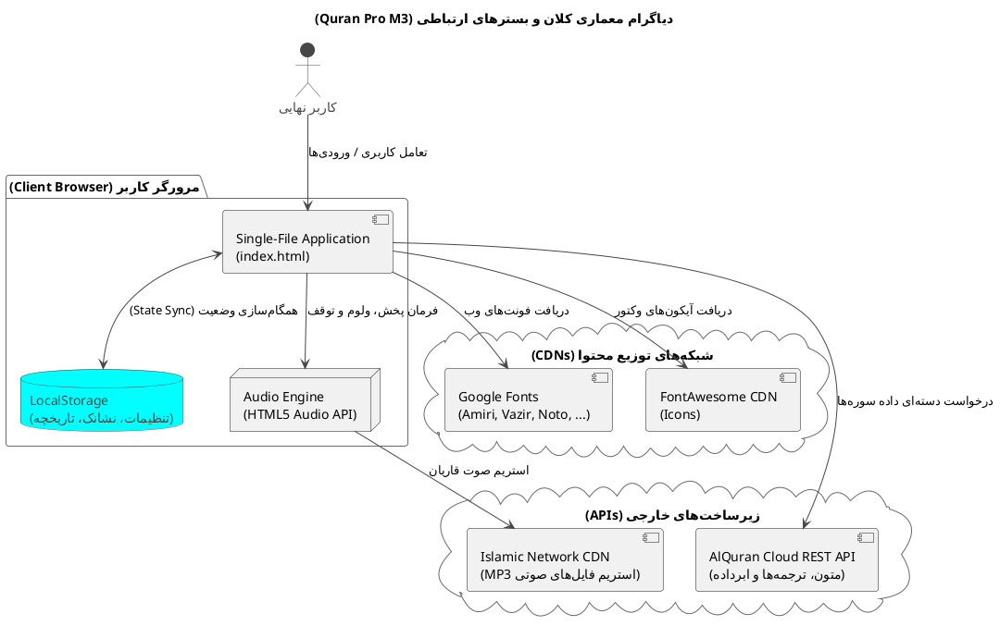
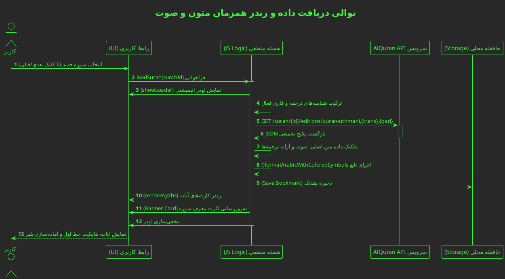
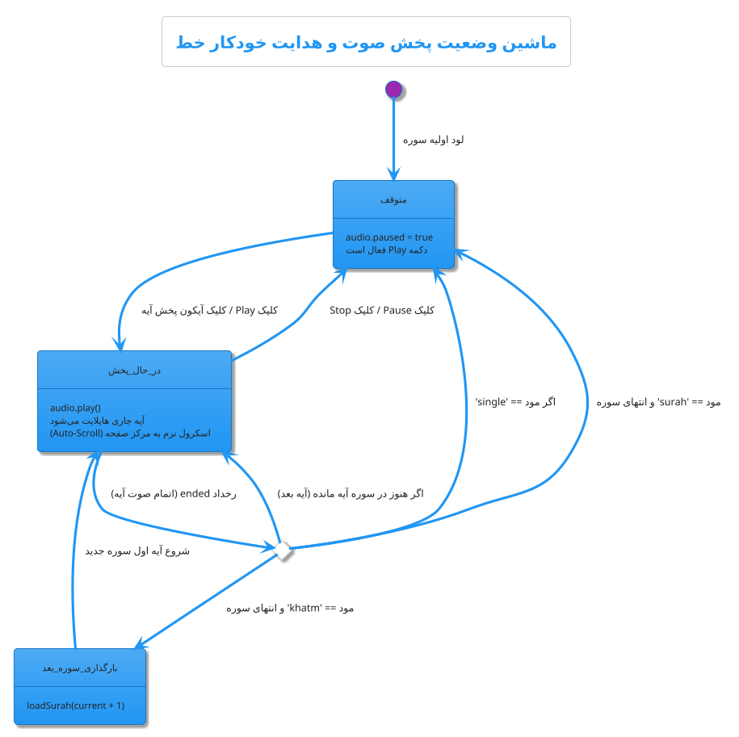
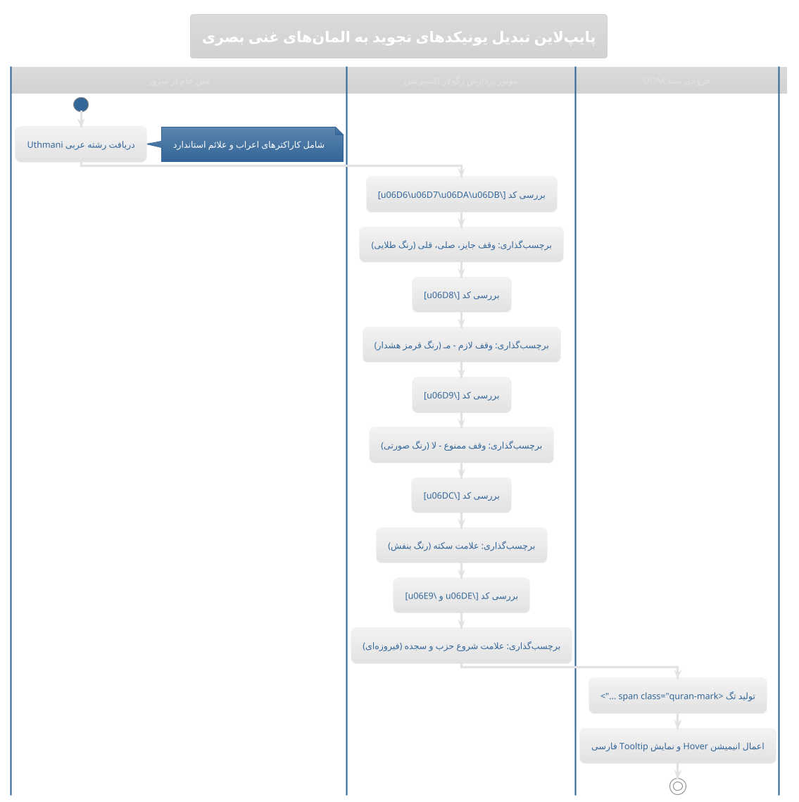
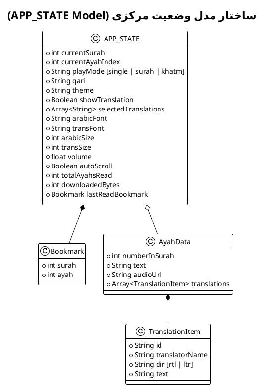
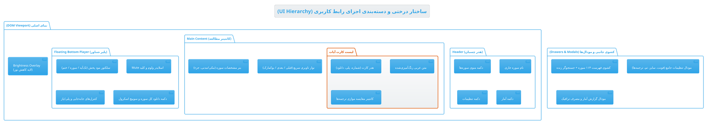
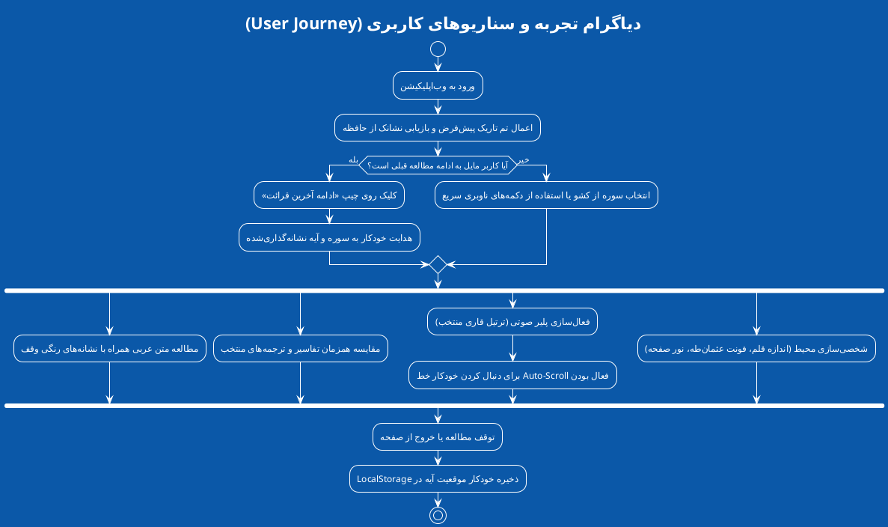

# 📖 سامانه جامع قرآن کریم | Quran Pro (Material 3)

<p align="center">
  
  
  
  
  
</p>

<p align="center">
  یک وب‌اپلیکیشن جامع، فوق‌سبک و بدون وابستگی (Zero-Dependency) برای قرائت، مطالعه تطبیقی تفاسیر، و استماع ترتیل کلام‌الله مجید بر پایه زبان طراحی مدرن <b>Material Design 3</b> گوگل.
</p>

<p align="center">
  <a href="#-دموی-آنلاین">مشاهده دمو</a> •
  <a href="#-ویژگی‌های-کلیدی">ویژگی‌ها</a> •
  <a href="#-پشت-صحنه-فنی">معماری فنی</a> •
  <a href="#-نحوه-راه‌اندازی">راه‌اندازی</a> •
  <a href="#-فونت‌ها-و-قاریان">قاریان و فونت‌ها</a>
</p>

---

## 🌟 دموی آنلاین
شما می‌توانید پیش‌نمایش زنده این سامانه را در لینک زیر تجربه کنید:
👉 **[مشاهده در CodePen](https://codepen.io/editor/Silent-Galaxy/pen/01a192b0-cbd7-7082-8434-665dfe2d6fae)**

---

## ✨ ویژگی‌های کلیدی


### 🔠 مطالعه تطبیقی چند ترجمه به صورت همزمان
- مشاهده موازی چند ترجمه معتبر زیر هر آیه (استاد انصاریان، مکارم شیرازی، فولادوند، الهی قمشه‌ای، بهرام‌پور، خرمشاهی و Saheeh International انگلیسی).
- امکان فعال یا غیرفعال‌سازی تک‌تک ترجمه‌ها طبق نیاز محقق.

### 🎨 رنگ‌آمیزی هوشمند علائم وقف و تجوید (Regex-Powered)
- تشخیص خودکار کدهای یونیکد علائم قرآنی نظیر:
  - **وقف لازم:** تفکیک قرمز و هشدار
  - **وقف ممنوع (لا):** صورتی یاقوتی
  - **سکته:** بنفش اختصاصی
  - **حزب و سجده:** نشانه‌گذاری متمایز

### 🎧 پلیر پیشرفته صوتی و دنبال‌کننده تلاوت
- **۳ حالت تلاوت:** تک‌آیه، سوره کامل، و ختم پیوسته قرآن بدون توقف میان سوره‌ها.
- **Auto-Scroll هوشمند:** هدایت نرم صفحه و هایلایت بصری همزمان با صدای قاری.
- **کنترل بلندی صدا (Volume Slider):** تنظیم ولوم از داخل رابط بدون نیاز به کلیدهای فیزیکی دستگاه.
- امکان دانلود تکی صوت هر آیه یا صف دانلود تمام سوره.

### 🌙 سلامت چشم و تم‌های چندگانه
- حالت شب (Dark Mode) پیش‌فرض و کمینه‌گرا با کنتراست ارگونومیک.
- اسلایدر اختصاصی برای کم کردن نرم‌افزاری نور صفحه برای مطالعه در تاریکی مطلق.
- ۸ پالت رنگی جذاب شامل: *زمردی، سرمه‌ای، طلایی، یاقوتی، بنفش و فیروزه‌ای*.

### ⚡ ذخیره‌سازی ابری و عملکرد بدون نیاز به سرور
- ثبت خودکار آخرین آیه خوانده شده (Bookmark) و پرش سریع به آن در مراجعات بعدی.
- سیستم آمار داخلی جهت محاسبه زمان مطالعه و تخمین حجم اینترنت مصرفی.

---

## 🛠 معماری و ساختار فنی

این نرم‌افزار به صورت **Single-File Application** طراحی شده و نیازی به هیچ مرحله کامپایل (`npm build`, `webpack`, `vite`) ندارد.

```text
├── index.html       # شامل تگ‌های سمانتیک، لایوت اصلی و ساختار دسترسی‌پذیری
├── CSS (Embedded)   # توکن‌های متریال ۳، متغیرهای CSS (:root)، مدیاکوئری‌های ریسپانسیو
└── JS (Embedded)    # مدیریت وضعیت (APP_STATE)، تعامل با API، کنترل رویدادهای Audio و DOM
```

### استانداردهای به‌کار رفته:
1. **Material Design 3 Tokenization:** تعویض آنی رنگ‌بندی با تغییر متغیرهای پویا بدون رندر مجدد DOM.
2. **RESTful API Consumption:** واکشی دینامیک بسته‌های سوره‌ها از سرویس مرجع `api.alquran.cloud`.
3. **Data Persistence:** نگه‌داری اطلاعات سشن، تنظیمات و نشانک در `Window.localStorage`.
4. **Regular Expression Parsing:** پردازش رشته‌های حاوی نمادهای عثمان‌طه بر پایه استانداردهای یونیکد زبان عربی:
   ```javascript
   text.replace(/([\u06D8])/g, '<span class="quran-mark mark-lazim">$1</span>');
   ```

---

## 🎙️ قاریان و قلم‌های پشتیبانی‌شده

| قلم‌های قرآنی و متنی | قاریان برجسته جهان اسلام |
| :--- | :--- |
| • امیری قرآنی (Amiri Quran - عثمان طه) | • مشاری راشد العفاسی |
| • شهرزاد نسخ (Scheherazade New) | • عبدالباسط عبدالصمد (مجود) |
| • نوتو نسخ گوگل (Noto Naskh Arabic) | • محمد صدیق منشاوی |
| • وزیرمتن (Vazirmatn) | • سعود الشریم |
| • لطیف (Lateef) | • شهریار پرهیزگار (تلاوت آموزشی) |

---

## 🚀 نحوه اجرا و استفاده

برای اجرای این پروژه روی سیستم خود تنها به یک مرورگر مدرن نیاز دارید:

```bash
# ۱. کلون کردن مخزن
git clone https://github.com/YOUR_USERNAME/quran-pro-material3.git

# ۲. ورود به دایرکتوری
cd quran-pro-material3

# ۳. اجرای فایل index.html (روی فایل دو بار کلیک کنید یا با مرورگر باز کنید)
```

یا با استفاده از یک لایو سرور سبک در پایتون:
```bash
python3 -m http.server 8000
```
سپس آدرس `http://localhost:8000` را در مرورگر باز کنید.

---

## 🤝 مشارکت در توسعه (Contributing)
پیشنهادات، گزارش باگ‌ها و افزودن ترجمه‌ها یا قابلیت‌های جدید صمیمانه استقبال می‌شود:
1. این ریپازیتوری را Fork کنید.
2. یک Branch برای قابلیت جدید خود ایجاد کنید (`git checkout -b feature/NewAwesomeFeature`).
3. تغییرات را Commit کنید (`git commit -m 'Add some NewAwesomeFeature'`).
4. برنچ را Push کنید (`git push origin feature/NewAwesomeFeature`).
5. یک Pull Request ارسال نمایید.

---

## 📄 لایسنس
این پروژه تحت لایسنس **MIT** به صورت کاملاً آزاد و متن‌باز (Open Source) منتشر شده است. استفاده، بازنشر و شخصی‌سازی آن برای تمامی اهداف غیرتجاری و تجاری بلامانع است.

<p align="center">
  با آرزوی بهره‌مندی و آرامش در تلاوت کلام وحی ✨
</p>


در ادامه **۷ دیاگرام استاندارد مهندسی نرم‌افزار با فرمت PlantUML** آماده شده است. این دیاگرام‌ها زوایای مختلف معماری (ارتباطات سیستم، چرخه داده، ماشین وضعیت صوتی، پایپ‌لاین پردازش تجوید، ساختار کامپوننت‌ها و سفر کاربر) را پوشش می‌دهند.

کدهای هر بخش را می‌توانید مستقیماً در **[ادیتور آنلاین PlantUML](https://editor.plantuml.com/)** کپی کنید تا تصویر خروجی را مشاهده فرمایید یا در انتهای فایل `README.md` در گیت‌هاب قرار دهید.

---

### ۱. دیاگرام معماری کلان سامانه (System Architecture Diagram)

> **هدف:** درک رابطه برنامه تک‌صفحه‌ای (Client-Side) با سرویس‌های ابری، شبکه CDN و حافظه محلی مرورگر.



---

### ۲. دیاگرام توالی بارگذاری سوره و ترجمه‌ها (Sequence Diagram)

> **هدف:** نمایش دقیق ترتیبات رویدادها از زمان انتخاب یک سوره تا پردازش، استخراج ترجمه‌ها و رندرینگ کارت‌ها روی صفحه.



---

### ۳. دیاگرام ماشین وضعیت پلیر صوتی (Audio State Machine)

> **هدف:** تشریح چگونگی مدیریت پخش پیوسته، رفتار پایان هر آیه بر اساس ۳ مود (تک‌آیه، سوره، ختم پیوسته)، و هماهنگی اسکرول خودکار.



---

### ۴. خط لوله پردازش علائم تجوید و وقف (Data Pipeline Diagram)

> **هدف:** بررسی زیرکاپوت نحوه تبدیل متون خام عثمان‌طه حاوی کدهای نامرئی یونیکد به المان‌های بصری غنی و رنگی.



---

### ۵. ساختار مدل داده وضعیت برنامه (State & Storage Class Diagram)

> **هدف:** نمایش شکل داده‌های متمرکز در `APP_STATE` و نحوه نگه‌داری ساختاریافته آبجکت‌ها درون حافظه.



---

### ۶. نقشه درختی اجزای رابط کاربری (Component Hierarchy Diagram)

> **هدف:** تفکیک ماژولار تمامی پنل‌ها، المان‌های شناور و پنجره‌های پاپ‌آپ داخل ساختار صفحه.



---

### ۷. دیاگرام سفر و جریان کاربری (User Journey Activity Diagram)

> **هدف:** توصیف تمام مسیرهایی که یک مخاطب (از ورود، تغییر شخصی‌سازی، تا مطالعه و ختم) می‌تواند در سامانه طی کند.



---
